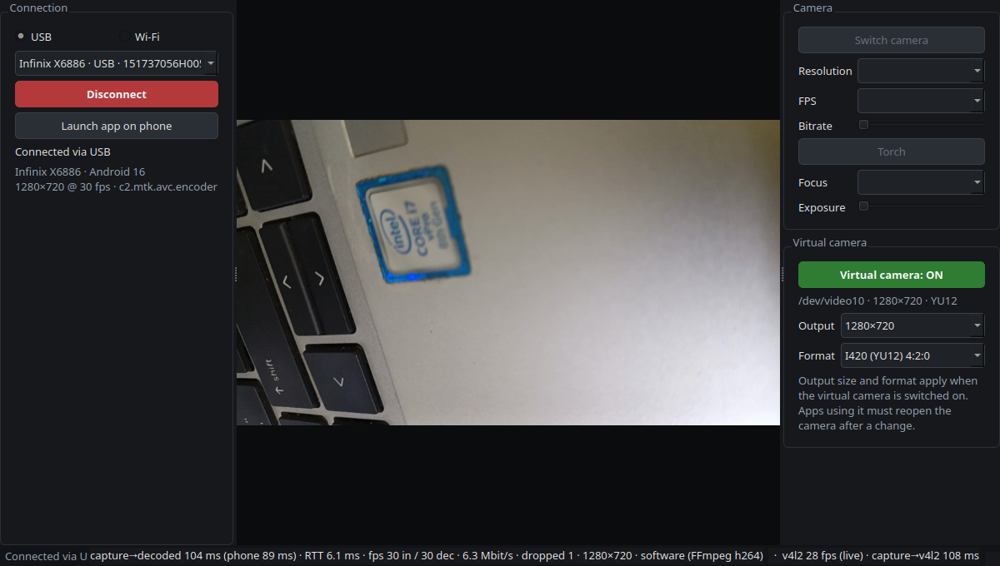
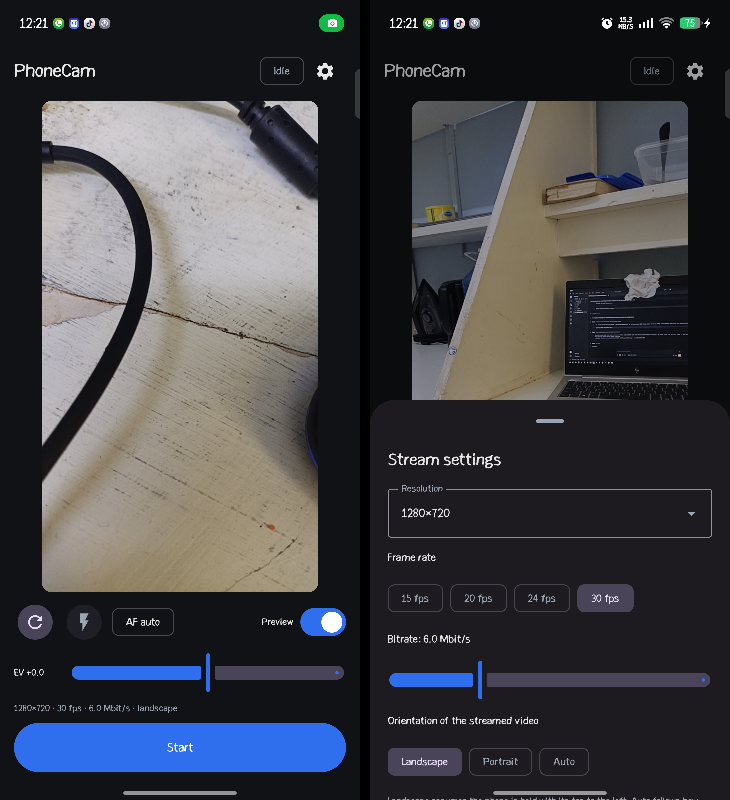
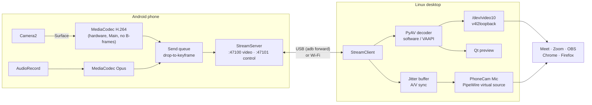

<div align="center">

# PhoneCam

**Turn an Android phone into a low-latency webcam and microphone for Linux.**

The phone streams hardware-encoded H.264 over USB or Wi-Fi. The desktop app exposes it as a
real V4L2 camera and a PipeWire microphone, so it works in Google Meet, Zoom, OBS, Chrome and
Firefox like any built-in device.

[](https://github.com/aresme/phonecam/actions/workflows/ci.yml)
[](LICENSE)




</div>

---

## Table of contents

- [Highlights](#highlights)
- [How it works](#how-it-works)
- [Performance](#performance)
- [Requirements](#requirements)
- [Quick start](#quick-start)
- [Usage](#usage)
- [Documentation](#documentation)
- [Project layout](#project-layout)
- [Development](#development)
- [Security and privacy](#security-and-privacy)
- [Known limitations](#known-limitations)
- [License](#license)

## Highlights

| | |
|---|---|
| **Real system devices** | Appears as the `PhoneCam` V4L2 camera (`/dev/video10`, via v4l2loopback) and the `PhoneCam Mic` PipeWire source. No browser extension or app plugin needed. |
| **Low latency, measured** | ~110 ms from capture to the virtual camera at 720p30 over USB, with a built-in latency lab: a millisecond timer, an automatic flash test, and an A/V sync test. |
| **USB or Wi-Fi** | `adb forward` over USB, or direct TCP on the LAN with mDNS auto-discovery and a pairing code. |
| **Full remote control** | Camera, resolution, fps, bitrate, torch, tap-to-focus, AF modes, exposure and orientation, controllable from both the phone and the PC and always kept in sync. |
| **Robust** | Auto-reconnects after cable or Wi-Fi drops, survives screen-off and backgrounding, resumes when another app releases the camera, and shows a placeholder so call apps never lose the device. |
| **Built from first principles** | Camera2 + MediaCodec on the phone, our own binary protocol, PyAV decoding, direct V4L2 writes. No third-party streaming stack. |

<p align="center">
  
</p>

## How it works



- **Phone:** frames go from the camera straight into the hardware encoder's input Surface
  (zero-copy). A two-frame send queue drops non-key frames and requests a sync frame when the
  link can't keep up, so latency stays bounded instead of growing with a TCP backlog.
- **Protocol:** a compact 20-byte framed binary protocol over two TCP connections: video/audio,
  and a bidirectional JSON control channel with PING/PONG clock sync. The full specification,
  with shared test vectors, is in [docs/protocol.md](docs/protocol.md).
- **PC:** dedicated threads for network, decode, V4L2 output, audio and control. Each consumer
  reads from a *latest-frame* slot, so a slow consumer never delays another. Capture timestamps,
  converted to the PC clock, drive both latency measurement and lip sync.

Threading model and design decisions: [docs/architecture.md](docs/architecture.md).

## Performance

Measured on an Infinix X6886 (MediaTek Helio G99) and an HP EliteBook 840 G5 (i7-8650U), at
1280×720, 30 fps, 6 Mbit/s:

| Metric | USB | Wi-Fi |
|---|---|---|
| Capture → frame written to `/dev/video10` | **~110 ms** | ~100–115 ms |
| Screen flash → frame read by a V4L2 consumer (glass-to-glass incl. source display) | **170 ms** median | 187 ms median |
| Round-trip time (control channel) | 3–6 ms | 2–4 ms |
| Audio vs. video (lip sync) | audio +81 ms | — |
| PC decode time per frame (software, CPU boost) | 5–7 ms | 5–7 ms |

About 90 ms of the total is the phone's camera pipeline (30 ms exposure plus a 4-stage ISP at
30 fps). Everything PhoneCam controls adds roughly 20 ms. The method, per-stage breakdown,
tuning experiments and full results log are in [docs/latency.md](docs/latency.md).

## Requirements

| Component | Requirement |
|---|---|
| Desktop | Linux with V4L2 and PipeWire; developed and tested on Ubuntu 26.04 (GNOME, Wayland) |
| Python | 3.12+ with PySide6, PyAV, numpy, zeroconf |
| Kernel module | [`v4l2loopback`](https://github.com/umlaeute/v4l2loopback) (installed by the setup script) |
| Phone | Android 7.0+ (API 24); Opus audio needs Android 10+ |
| USB mode | `adb` and USB debugging enabled on the phone |
| Building the APK | JDK 17+, Android SDK (compileSdk 37); Gradle comes with the wrapper |

## Quick start

**1. Clone and set up the virtual camera** (one time; asks for your password):

```bash
git clone https://github.com/aresme/phonecam.git && cd phonecam
scripts/setup-v4l2loopback.sh --persist     # /dev/video10 "PhoneCam", loaded at every boot
```

**2. Install the desktop app:**

```bash
sudo apt install adb python3-pyside6.qtwidgets python3-numpy
cd pc
python3 -m venv --system-site-packages .venv
.venv/bin/python -m pip install -e .
.venv/bin/phonecam --install-desktop        # adds PhoneCam to the app grid
```

**3. Install the phone app.** Download the APK from
[Releases](https://github.com/aresme/phonecam/releases), or build it:

```bash
cd android && ./gradlew assembleDebug
adb install -r app/build/outputs/apk/debug/PhoneCam-*-debug.apk
```

**4. Stream.** Start PhoneCam on the PC, plug in the phone, click **Launch app on phone**, then
**Connect**. In your call app choose the camera **PhoneCam** (and, optionally, the microphone
**PhoneCam Mic**).

> [!TIP]
> On Ubuntu, `python3 -m venv` may lack pip (no `ensurepip`). Use
> `python3 -m venv --without-pip --system-site-packages .venv` and then `.venv/bin/python -m pip`,
> which uses the system pip module inside the venv.

## Usage

| Task | How |
|---|---|
| Connect over USB | Pick the device under **USB** → **Connect**. Reconnects automatically after unplug or replug. |
| Connect over Wi-Fi | Tap **Start** on the phone, choose **Wi-Fi** on the PC, select the discovered phone, and enter the 4-digit pairing code shown on the phone once. |
| Change camera settings | Use the right-hand panel on the PC or the quick controls and ⚙ sheet on the phone; both stay in sync. Click or tap the preview to focus. |
| Portrait video | Orientation → **Portrait** (or **Auto**), and pick a portrait output size such as 720×1280. |
| Microphone | Tap 🎤 on the phone once to grant permission, then enable **Stream phone microphone** and select **PhoneCam Mic** in your app. |
| Measure latency | Virtual camera panel → **Latency test…**: **F** flash test, **A** A/V sync test, **Space** timer snapshot. |

The complete guide is [docs/user-guide.md](docs/user-guide.md). If something doesn't work, see
[docs/troubleshooting.md](docs/troubleshooting.md).

## Documentation

| Document | Contents |
|---|---|
| [User guide](docs/user-guide.md) | Setup, USB and Wi-Fi, controls, microphone, latency tools, settings |
| [Troubleshooting](docs/troubleshooting.md) | Browser device lists, Secure Boot, client isolation, firewalls, audio |
| [Architecture](docs/architecture.md) | Components, threading model, drop policy, A/V sync, design decisions |
| [Protocol](docs/protocol.md) | Wire format specification and shared test vectors |
| [Latency](docs/latency.md) | Measurement method, stage breakdown, tuning experiments, results log |
| [Development](docs/development.md) | Building, testing, debugging, the fake-phone simulator |
| [Changelog](CHANGELOG.md) | Release notes |

## Project layout

```
phonecam/
├── android/        Android app: Kotlin, Jetpack Compose, Camera2, MediaCodec (minSdk 24)
├── pc/             Desktop app: Python, PySide6, PyAV, V4L2 and PipeWire output
│   ├── phonecam/   package (client, decoder, v4l2, audio, GUI, tools/fake_phone)
│   └── tests/      pytest suite incl. end-to-end pipeline tests against a simulated phone
├── docs/           specification, architecture, latency lab, guides, test vectors
├── scripts/        v4l2loopback setup, VAAPI PyAV build, dev runner, vector generator
└── .github/        CI workflow
```

## Development

```bash
# Desktop app: tests and lint
cd pc && .venv/bin/python -m pip install -e ".[dev]"
.venv/bin/python -m pytest && .venv/bin/python -m ruff check .

# Android: unit tests and debug build
cd android && ./gradlew testDebugUnitTest assembleDebug

# No phone at hand? Serve a recording over the real protocol and connect via Wi-Fi to 127.0.0.1
.venv/bin/python -m phonecam.tools.fake_phone tests/data/phone-720p-12f.h264 --announce
```

Both implementations of the wire protocol are tested against the same byte-level vectors in
`docs/test-vectors/`. More in [docs/development.md](docs/development.md).

## Security and privacy

- The stream is **not encrypted**. Use USB, or Wi-Fi on networks you trust.
- Wi-Fi connections require a **pairing code** shown on the phone. Unpaired clients can neither
  view the stream nor take over an existing session. This keeps casual users of a shared network
  out; it is not protection against someone who can sniff the network.
- The microphone is **off by default** and must be enabled explicitly. Android shows its usual
  camera and microphone privacy indicators while streaming.

## Known limitations

- The phone's camera pipeline sets the latency floor; on the reference device it is ~90 ms at
  30 fps. Phones that support 60 fps capture or have a faster ISP get lower latency.
- Some Wi-Fi networks (guest, campus, public) isolate clients from each other. Use USB or the
  phone's hotspot there.
- Linux only. The desktop side relies on v4l2loopback and PipeWire.

## License

Released under the [MIT License](LICENSE).
