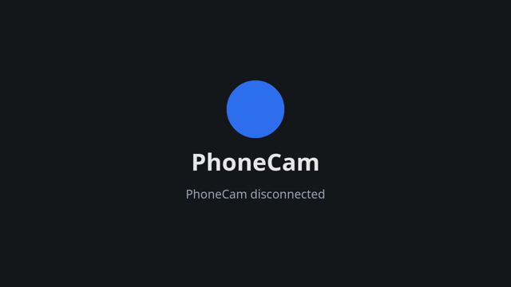
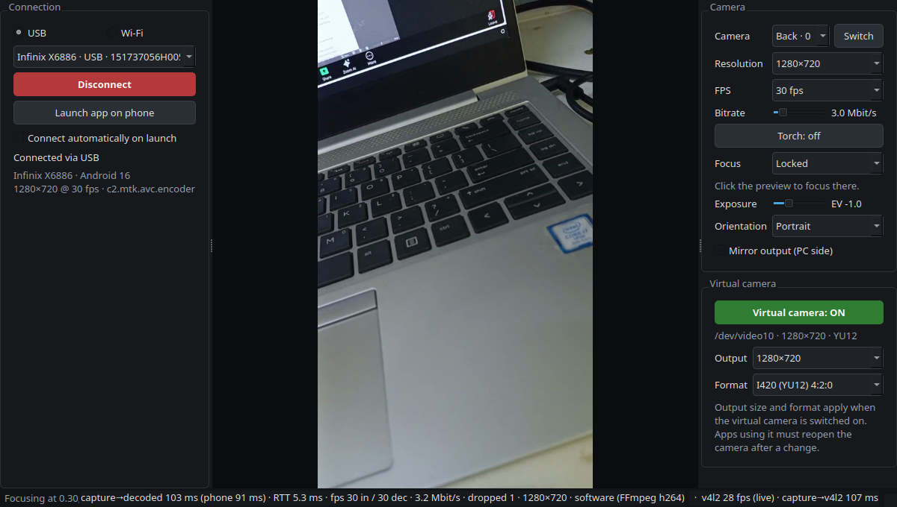
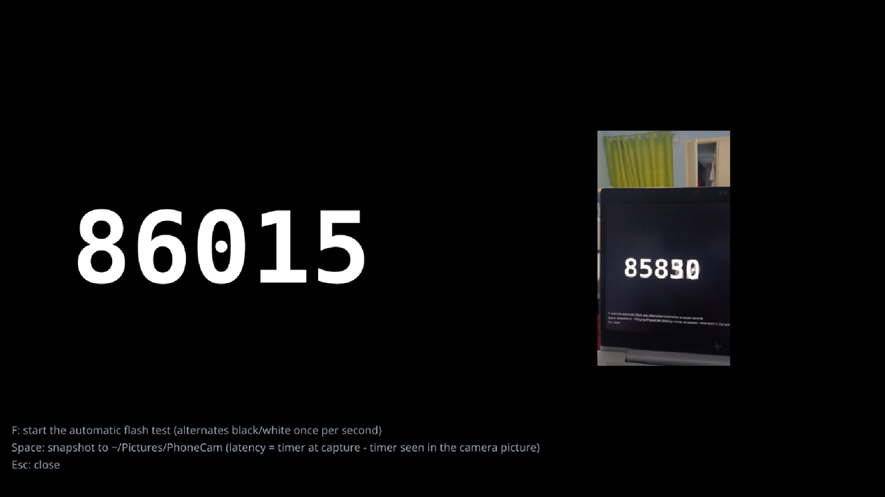

# User guide

- [1. One-time setup](#1-one-time-setup)
- [2. Connecting over USB](#2-connecting-over-usb)
- [3. Connecting over Wi-Fi](#3-connecting-over-wi-fi)
- [4. Using PhoneCam in other apps](#4-using-phonecam-in-other-apps)
- [5. Camera controls](#5-camera-controls)
- [6. Microphone (PhoneCam Mic)](#6-microphone-phonecam-mic)
- [7. Latency tools](#7-latency-tools)
- [8. Tray icon, autostart and settings](#8-tray-icon-autostart-and-settings)
- [9. Recording a test clip on the phone](#9-recording-a-test-clip-on-the-phone)

---

## 1. One-time setup

### Virtual camera (v4l2loopback)

PhoneCam writes video into a v4l2loopback device. Either let the desktop app's first-run dialog
set it up (it asks for your password through the normal desktop prompt), or run:

```bash
scripts/setup-v4l2loopback.sh --persist
```

This installs `v4l2loopback-dkms` if needed, creates `/dev/video10` with the card label
`PhoneCam` and `exclusive_caps=1` (required by Chrome), and loads it at every boot. If Secure
Boot is enabled, the DKMS module must be signed with an enrolled key; see
[Troubleshooting](troubleshooting.md#secure-boot-key-was-rejected-by-service).

### Desktop app

```bash
cd pc
python3 -m venv --without-pip --system-site-packages .venv   # reuses the distro's PySide6/numpy
.venv/bin/python -m pip install -e .
.venv/bin/phonecam --install-desktop    # app-grid entry + icon (~/.local/share)
```

`phonecam --uninstall-desktop` removes the entry again. Run `phonecam --debug` for verbose logs.

### Phone app

Install the APK from the releases page, or build it (`android/`, `./gradlew assembleDebug`). On
first start, PhoneCam explains and requests the camera permission, and on Android 13+ the
notification permission. The notification is used for the "streaming" status and its Stop action.

## 2. Connecting over USB

1. Enable *USB debugging* on the phone and plug it in. Accept the RSA prompt.
2. Start PhoneCam on the PC. The phone appears in the **USB** device list.
3. Click **Launch app on phone** (or open PhoneCam on the phone and tap **Start**).
4. Click **Connect**.

If the cable is unplugged, the phone app restarts, or the phone isn't streaming yet, the PC keeps
retrying with backoff (0.5 s → 5 s) and shows the reason in the status line.

## 3. Connecting over Wi-Fi

1. Put the phone and the PC on the same network and tap **Start** on the phone. The phone shows
   its address(es) and a 4-digit **pairing code** under the preview.
2. On the PC choose **Wi-Fi**. Phones running PhoneCam are discovered automatically (mDNS,
   `_phonecam._tcp`) and listed above recent addresses. You can also type an IP.
3. Click **Connect** and enter the pairing code once. It is remembered per address.

USB never needs the code. On the phone, the ⚙ sheet can renew the code or disable pairing.
While streaming, the phone holds a low-latency Wi-Fi lock so power saving doesn't add delay.

> [!NOTE]
> Guest, campus and public networks often isolate clients from each other. The phone may still
> be discovered, but connecting times out. Use USB or the phone's hotspot; see
> [Troubleshooting](troubleshooting.md#wi-fi-the-phone-is-listed-but-connecting-times-out).

## 4. Using PhoneCam in other apps

- **Camera:** choose **PhoneCam** in Meet, Zoom, OBS (V4L2 source), Chrome or Firefox. The virtual
  camera is on by default. While no phone is connected it shows a "PhoneCam disconnected" card,
  so apps keep the device open.

  

- **Output size and format:** set in the *Virtual camera* panel. The default is 1280×720 I420;
  YUYV is a compatibility fallback. Changes apply the next time the virtual camera is switched
  on, and apps must reopen the camera afterwards.
- **Microphone:** choose **PhoneCam Mic** (see [section 6](#6-microphone-phonecam-mic)).

## 5. Camera controls

Everything can be changed from either side, and both UIs stay in sync. The phone is
authoritative and pushes its state on every change.



| Control | PC | Phone |
|---|---|---|
| Switch camera | Camera list / **Switch** | ⟳ button |
| Resolution, FPS | Drop-downs (only modes the camera *and* encoder support) | ⚙ sheet |
| Bitrate | Slider (0.5–20 Mbit/s, applied live) | ⚙ sheet |
| Torch | **Torch** button | ⚡ button |
| Focus | Mode list; click the preview to focus there (AF becomes *Locked*) | AF chip; tap the preview |
| Exposure | EV slider | EV slider |
| Orientation | Landscape / Portrait / Auto | ⚙ sheet |
| Mirror | *Mirror output* (applied on the PC) | — |

**Orientation.** Video is encoded in the sensor's native orientation, and each frame carries a
rotation hint that the PC applies. *Landscape* assumes the phone is held with its top to the
left. *Portrait* is for a phone standing upright. *Auto* follows the phone's orientation sensor.
For a portrait stream, pick a portrait output size (720×1280); otherwise the picture is
pillarboxed.

**Decoder and CPU.** Software decoding has the lowest latency on modern CPUs. *VAAPI* uses less
CPU and needs PyAV built against the system FFmpeg (`scripts/build-pyav-vaapi.sh`). *Boost CPU
while streaming* holds the *performance* power profile while connected, which roughly halves
decode time on laptops.

## 6. Microphone (PhoneCam Mic)

The microphone is off by default.

1. On the phone, tap 🎤 once and allow the microphone. After that, it can be toggled from either
   side; on the PC it's *Stream phone microphone*.
2. Select **PhoneCam Mic** as the microphone in your app. The source exists while the desktop app
   runs and is silent while the phone mic is off.
3. *Mic mode*: **Voice** uses the phone's call processing (echo cancellation, noise suppression).
   **Raw** is the unprocessed microphone.
4. *A/V sync*: by default the audio is delayed to match the video delay (minus the virtual
   source's own ~30 ms). Untick it to set a fixed delay instead. Audio can't be made earlier than
   its arrival time.

## 7. Latency tools

- The status bar shows *capture → decoded* and *capture → v4l2*. Hover it for the per-stage
  breakdown (phone camera, encode, network, decode).
- **Latency test…** (virtual camera panel) opens a full-screen test window. Point the phone at
  the screen:
  - **F**: automatic flash test. The window alternates black and white, and the time until the
    change appears in frames read back from `/dev/video10` is measured.
  - **A**: A/V sync test. Flash plus a beep, heard through PhoneCam Mic. Needs the speaker on and
    the phone mic enabled.
  - **Space**: snapshot to `~/Pictures/PhoneCam`. Latency = timer at capture (in the file name) −
    timer visible in the camera picture.

  

Method and reference results: [latency.md](latency.md).

## 8. Tray icon, autostart and settings

- With a system tray (Ubuntu's AppIndicator extension is enabled by default), closing the window
  keeps PhoneCam running in the tray. The tray menu has *Show window*, *Connect/Disconnect*,
  *Switch camera*, *Virtual camera* and *Quit*. Without a tray, closing the window quits.
- Only one PhoneCam runs per session. Launching it again brings the existing window to the front.
- *Connect automatically on launch* reconnects to the last device.
- Settings persist on both sides: on the PC in `~/.config/PhoneCam/PhoneCam.conf`, on the phone
  in app-private storage (DataStore).
- Starting to stream at phone boot is intentionally not offered: Android 14+ doesn't allow camera
  foreground services to start from a boot receiver.

## 9. Recording a test clip on the phone

1. In the phone's ⚙ sheet, enable **Also record to file**, tap **Start**, then **Stop**.
2. Pull and play the raw H.264 stream:

```bash
adb shell ls /sdcard/Android/data/com.ares.phonecam/files/recordings/
adb pull /sdcard/Android/data/com.ares.phonecam/files/recordings/<file>.h264
ffplay -f h264 -framerate 30 <file>.h264
```

The clip is in the sensor's orientation (landscape).
